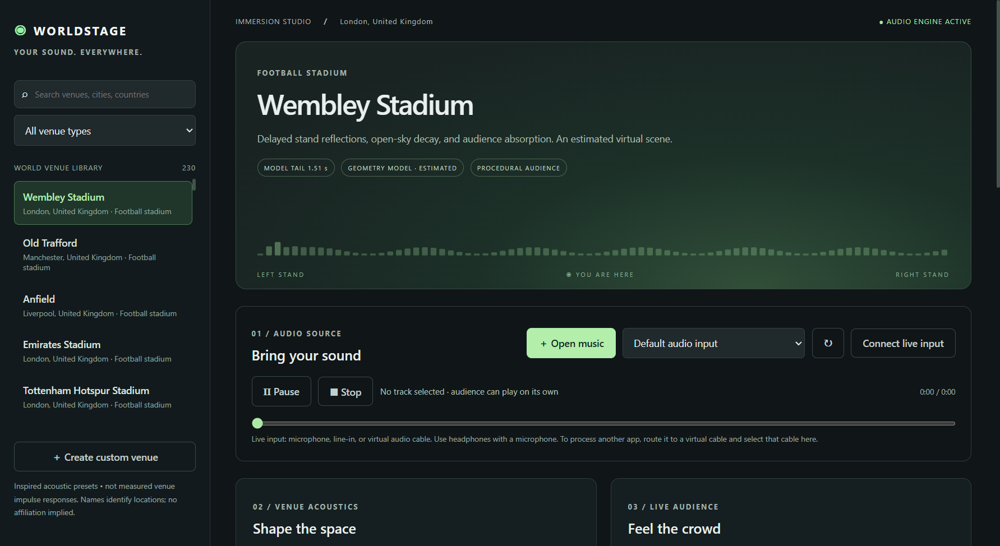

# WorldStage 1.1

A Windows music player with simulated venue acoustics and audience immersion.

**[Download WorldStage for Windows x64](https://github.com/oliverpeter147-dot/worldstage/releases/latest)**

The portable app needs no installation. Open the `.exe`, choose a venue, open a music file, and start the audience. This is an unsigned build; Windows may display a publisher warning.



## New in 1.1

Stadiums now use delayed stand reflections, listening-position geometry, roof enclosure, audience absorption and a frequency-dependent tail. Import a measured WAV impulse response to replace the simulation. Spotify Connect remote controls add account authorization, device selection, playback controls and track/album/playlist links.

Spotify playback remains in Spotify and is not processed by venue effects. Setup requires your own developer Client ID and the access Spotify grants it; playback commands require Premium. See the guide for the exact redirect URI and restrictions.

## Features

- 230 searchable presets across football stadiums, festivals, theatres, opera houses, bars, cafés, nightclubs, churches, cathedrals, arenas and concert halls.
- Local music playback and explicitly selected live audio inputs.
- Room mix, reverb decay, listening distance and bass controls.
- Synthesized crowd ambience with adjustable level, energy, size and applause swells.
- Looping playback of your own crowd recordings.
- Custom venues and locally saved mix settings.
- Offline runtime with no account or audio upload required.

## Acoustic scope

Stadium presets use distinct estimated virtual scenes, not surveyed geometry. Other presets use category-based estimates. All bundled responses are synthetic. They are not measured replicas of the named venues. The library is curated and not exhaustive, and includes historical settings. Venue names imply no affiliation or endorsement. The built-in crowd is noise-based synthesis rather than recorded people or intelligible chants. Load a real crowd recording for a more authentic audience.

WorldStage processes its own playback or a connected audio input. Audio from another application requires a separately installed virtual audio cable. It does not automatically apply effects to every Windows sound. Use headphones with microphone input to prevent acoustic feedback.

Read [the quick-start guide](WorldStage-1.1-Guide.md) for playback and routing instructions.

## Build

Requires Node.js and npm. From this repository:

```sh
npm ci
npm test
npm start
npm run dist
```

The executable is built with Electron 44.9.0 and electron-builder 26.0.12. Builds require network access to download dependencies. For faster packaging with a larger output, use `npm run dist -- --config.compression=store`.

## Validation

The Windows portable executable passed startup, decoded WAV playback, generated crowd output, effects bypass, master mute, venue search and category filtering checks. See [the validation results](WorldStage-1.1-Validation.json). Physical live audio inputs and virtual-cable routing require checking on your own hardware. Acoustic authenticity has not been validated against measurements.

Eight automated acoustic/Spotify-service tests pass using mocked Spotify API responses and a real loopback OAuth callback. A live Spotify account has not been tested because no Client ID was supplied.

Release downloads include the executable, editable source archive, guide and SHA-256 checksum. Electron and its dependencies retain their own third-party notices.
